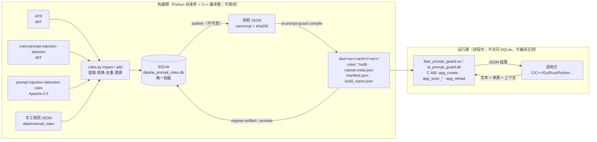
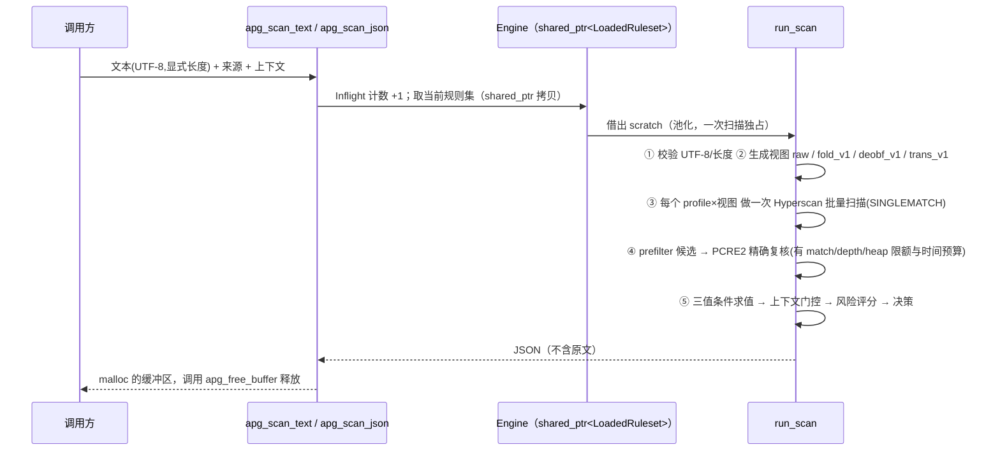

# 架构说明 / Architecture

> 状态说明：本文描述的 **Python 规则工具链与 SQLite 规则库已在开发机上实际运行**；**C++ 引擎、Hyperscan 编译器、C ABI、DLL/SO 已完整编码，但从未被编译或运行过**（开发机无 C/C++ 编译器，任务书禁止在用户机器上安装）。凡是涉及 C++ 行为的句子都应读作“设计/预期行为”，实测见 `reports/validation_matrix.md`。

## 1. 目标与边界

做什么：给一段（或多段）文本，**在进程内**返回“是否像提示词注入”的结构化判断（命中的规则、风险分、决策、证据偏移），中文 / 英文 / 中英混合。

- SQLite 是**唯一权威**的规则数据源；Hyperscan 是**主匹配引擎**；核心是 C++17，对外只有一个稳定的 **C ABI**；同一套代码构建 Windows DLL 与 Linux SO。
- 不做：APISIX 插件、HTTP 服务、Web UI、模型/语义判别。规则只能表达“正则可表达的信号”；上游的 embedding / LLM judge 类规则被明确记录为 `unsupported`，没有伪装成正则。
- 默认只给出 `allow / review / alert`（alert-only）；`block` 必须显式开启。

## 2. 总览

两条硬性边界：

1. **运行时库从不打开 SQLite，也不编译任何正则。** 它只读 manifest + `.hsdb` + `ruleset.meta.json`，三者互相用 SHA-256 绑定。
2. **C++ 从不写 SQLite。** 所有写操作（导入、修订、发布、登记产物、激活/回滚）都经过 `tools/rules.py`，保证事务、不可变触发器和审计哈希链只有一份实现。

## 3. 模块职责

| 目录 | 职责 | 语言 | 已执行验证 |
|---|---|---|---|
| `tools/apg_rules/` | 来源同步与锁定、YAML/AST 提取、正则转换与分类、导入、维护、校验、发布、参考引擎、报告 | Python 3（仅标准库） | 是（100 个单元测试 + 真实库构建） |
| `tools/sources/` | 三个上游的 importer 插件（`atr` / `trans_pid` / `fevzi_pidr`） | Python | 是 |
| `sql/001_init.sql` | 完整 schema、触发器、视图 | SQL | 是 |
| `engine/core/` | UTF-8/JSON/SHA-256/归一化、Hyperscan 与 PCRE2 后端、场景评估（`scanner.cpp`） | C++17 | **否（未编译）** |
| `engine/ruleset/` | 快照解析、manifest 校验与加载、**规则编译器** | C++17 | **否** |
| `engine/storage/` | SQLite 只读访问（仅 CLI/编译器使用） | C++17 | **否** |
| `engine/api/` | `Engine` 对象（热更新/销毁协议）与 C ABI 外壳 | C++17 | **否** |
| `cli/` | `ai-prompt-guard`：compile / verify / info / scan / scan-batch / bench / versions，并转发规则管理命令到 Python | C++17 | **否** |
| `tests/` | Python 单元测试、C++ 单元测试、端到端脚本、语料与预期结果 | Python / C++ | Python 部分是；C++/e2e 否 |

## 4. 构建期数据流（已执行）

1. `sources sync --locked`：把三个仓库物化为**无 .git 的干净快照**（`third_party/sources/`），每个文件的 SHA-256 与整棵树的 hash 写进 `third_party/sources.lock.json`。ATR 含 Windows 非法文件名，所以不用 `git checkout`，而是 `git cat-file --batch` 读取对象并自行校验路径。
2. `import`：每个 importer 把上游规则变成统一的 `SrcRule`/`SrcPattern`（**不执行上游代码**：ATR 用自带的 `miniyaml`，两个 Python 来源用 `ast`）。`pipeline.prepare_rule` 对每个模式做 `convert_pattern`：
   - 方言（ES / Python `re` / PCRE）→ 统一的“PCRE 兼容 + Hyperscan 可编译”规范形式，flags 取 `imsu` 子集；
   - ES 语义还原（`.`、`\s`、`$`、代理对写法）、Python 语义（`\Z`→`\z`）、lookbehind 展开；
   - 语言作用域：对外语（日/德/韩/西…）的分支做**精确子集裁剪**，整条都是外语则 `excluded_language`，并保留证据；
   - 分类：`hs_native`（真正正则语言）/ `hs_prefilter_pcre2`（含 lookahead、反向引用、原子组…，Hyperscan 只做预过滤，必须经 PCRE2 复核）/ `unsupported`（可空匹配、孤立代理、变长 lookbehind、语义类方法）。
3. 去重：同一 `(regex, flags, profile)` 只有一个 `pattern_id`（从 10001 起，永不复用）；规则通过 `rule_pattern_links` 引用。同一证据的两条规则在发布时被分到同一 `score_group`（见 §6）。
4. `verify-tests`：用 **Python 参考引擎** 复算上游所有测试样例（含 ATR 的多输入字段语义）；不一致或不可编译的会被标记，不会静默通过。
5. `publish`：只从不可变的 `rule_revisions` / `rule_patterns` 生成**规范 JSON 快照**（键排序、无空白、UTF-8），其 SHA-256 写入 `ruleset_versions.snapshot_sha256`；发布后的版本被触发器冻结。两次全新构建得到逐字节相同的快照（已验证）。
6. `compile`（C++，待 Linux 验证）：读取已发布快照 → 按归一化 profile 分组 → `hs_compile_multi`（`HS_FLAG_UTF8|SINGLEMATCH`，需要时 `PREFILTER`）→ 出错的单个表达式先降级为 prefilter（PCRE2 能复核才接受），再不行就**隔离**并在 `build_report.json` 里给出确切错误、使用它的规则和上游溯源；写 `.building` 临时目录、**加载自检**通过后原子改名。

## 5. 运行期数据流（C++，待 Linux 验证）

要点：

- **每个 profile 每个视图只扫描一次**（不是逐条规则扫描）；相同的视图（归一化后与原文一致）只扫一遍。
- **只有 PCRE2 复核成功的命中才进入风险判定**；复核超限/超时记为 warning，并按 `policy.on_verify_error` 决定是否升到 `review`。
- 输入问题（非法 UTF-8、过长、候选过多）不会让 C 函数失败，而是返回 `status:"error"` 的结构化结果，决策取自 `policy.on_error`（默认 `review`，不会悄悄放行）。
- 结果里只有**偏移量**（`evidence`），没有匹配到的文本，默认日志不会泄露敏感内容。

## 6. 规则模型与评分语义

**统一规则** `AIPS-<类别码>-NNNN`（稳定 ID，`id_counters` 单调分配，删除只做软删除）：

| 字段 | 含义 |
|---|---|
| `category` | prompt_injection / jailbreak / role_spoofing / instruction_override / instruction_hijacking / system_prompt_extraction / safety_bypass / obfuscated_injection / data_exfiltration_instruction |
| `severity` | info…critical：**影响有多大**，不是置信度 |
| `weight`、`confidence` | 风险 = `weight × confidence × 来源系数`；`confidence` 表示“命中后真是攻击的概率” |
| `condition` | `any / all / not` 条件树，叶子 = (pattern_id, field)。ATR 的多条件、`NOT`、字段约束完整保留 |
| `scope` / `context_requires` | 如 `translation_only` → 需要请求上下文 `{"task":"translation"}` |
| `score_group` | 同组规则只计最大值，不叠加（上游 trans 检测器的各组；以及“证据完全相同”的规则自动同组） |

**三值逻辑**：叶子所需字段**没有提供**时取值 *unknown*（不是 false）。`any`：有真即真，全假才假，否则 unknown；`all`：有假即假，全真才真，否则 unknown；`not` 保持 unknown。unknown 且已有部分证据 → 记入 `needs_context`（`reason: field_missing`），**不计入分数**。上下文缺失同理（`context_missing`）；上下文不匹配则规则“不适用”，什么也不报。

**评分**：每条命中规则的风险 = `weight × confidence × 来源系数`（user_input 1.00，tool_output/rag_document 1.15，agent_message 1.10），截断到 [0,1]；同 `score_group` 取最大；各组按 noisy-OR 合成：`score = 1 − Π(1 − risk_g)`。

**决策**（默认阈值，可由配置覆盖）：`score ≥ 0.50 → alert`；`≥ 0.30 → review`；否则 `allow`。`score ≥ 0.85` 且 `policy.allow_block=true` 才是 `block`。`needs_context` 里的规则**永远不计入分数**，但如果其风险 ≥ `needs_context_review_at`（默认 0.50，即“补上上下文就会 `alert`”），`allow` 会被抬到 `review`（“降一档”，绝不会抬到 `alert`——条件并未成立）。没有翻译类场景的部署可以用 `policy.needs_context_review_at`（1.0 ≈ 关闭）降低噪声；发现仍然会出现在 `needs_context[]` 里。

风险等级：`≥0.80 critical`、`≥0.60 high`、`≥0.40 medium`、`≥0.15 low`，其余 `info`；无命中 `none`。

> 这些数值是**默认值与设计选择**，不是经过大规模真实流量校准的结论；见 `reports/false_positive.md` 的限制说明。

## 7. 归一化（版本化，`tables_version = 1`）

| profile / view | 作用 |
|---|---|
| `raw` | 原文 |
| `fold_v1` | 删除不可见/格式/双向控制字符（零宽、BOM、RLO…）→ 单字符 NFKC（全角→半角、花体、连字…）→ ATR 的西里尔/希腊形近字映射到拉丁。**中文不变。** 每个字节带原文偏移 |
| `deobf_v1` | 在 `fold_v1` 之上的反混淆视图（无新增表）：① CJK 字符之间的分隔符（空格、`.` `-` `_` `*` `|` `/` 等，**不含**逗号、分号、换行等句读）删除，`忽 略 之 前` → `忽略之前`；② 3 个以上单个 ASCII 字母被**同一种**分隔符连接（`i.g.n.o.r.e`）时连成词；③ 词内 leetspeak 还原（至少 3 个字符、含字母和 leet 字符的 token：`0→o 3→e 4→a 5→s 7→t @→a $→s`，`1→i`，连续两个以上的 `1`→`l`），纯数字 / 价格不动。偏移照常映射回原文 |
| `trans_v1` | 翻译检测器 `preprocess_text` 的精确复刻（去首尾空白、零宽、同形字、控制符、CJK 标点→ASCII…），**不做小写**（该来源的模式编译为不区分大小写） |

规则 profile `fold_v1` 同时扫 `fold_v1` 与 `raw` 两个视图（ATR 语义：归一化视图优先，原文兜底）；profile `deobf_v1` 依次扫 `deobf_v1`、`fold_v1`、`raw`（1.1.0 起除翻译来源外的全部规则使用它，所以 1.0.0 的命中是 1.1.0 的子集）。`deobf_v1` 只在文本确实被改动时才多扫一遍。C++ 表由 `tools/gen_unicode_tables.py` 从 Python `unicodedata` 生成并随源码提交（Unicode 16.0.0），`tests/fixtures/normalize_golden.jsonl` 是 Python 规范与 C++ 实现的共同黄金向量（C++ 侧待 Linux 验证）。

## 8. 版本、产物与一致性

- 发布版本（`ruleset_versions`）与其成员/模式/快照由触发器冻结；`rollback` 只移动 `active_ruleset` 指针并写审计，**从不改历史**。
- `manifest.json` 绑定：快照 SHA-256、每个 `.hsdb` 的 SHA-256、目标 OS/arch/后端、Hyperscan 版本、CPU 特性掩码、ABI 与归一化版本、自身 `build_hash`。任何不一致都是错误，**不存在“混搭”**。
- **`.hsdb` 不可移植**：与 Hyperscan 版本、CPU 指令集（`generic` 目标可降低但不能消除限制）、操作系统绑定。正确做法是在目标机器上用 SQLite 里已发布的快照**离线重新编译**。
- 激活指针 `dist/<os>/<arch>/active.json`（含 manifest 的 SHA-256）让 `apg_create/apg_reload` 无需知道具体版本目录。

## 9. 并发与热更新（设计）

- `apg_context_t` 可被任意多线程共享；每次扫描独占一个 scratch（池化，数量上限可配置，不会跨线程共享）。
- `apg_reload`：新规则集的**全部**加载与校验（含创建首个 scratch）完成后才原子替换 `shared_ptr`；在途扫描继续使用旧规则集；失败时旧规则集原样保留。
- `apg_destroy` 等待“在它之前已经开始”的扫描/重载结束；销毁之后（或与之并发地）再使用句柄是调用方的错误（任何 C API 都无法防御）。

## 10. 关键设计决策

| 决策 | 理由 | 代价 / 风险 |
|---|---|---|
| 构建期 Python、运行期 C++ | 规则管理需要灵活的文本处理；运行期不应依赖解释器 | 规则管理命令需要 Python 3；CLI 通过转发调用 |
| 自带 `miniyaml` | 构建机无 PyYAML 且不得安装；`yaml.load` 对不可信输入不安全 | 只支持上游用到的子集，遇到不认识的语法**报错而非跳过** |
| 不执行上游代码，用 AST/安全 YAML 解析 | 供应链安全 | 上游改写法时 importer 需更新（有断言保护） |
| 快照 canonical JSON + SHA-256 | 可复现、可比对、可审计 | 快照约 1.7 MB（352 条规则） |
| 参考引擎（Python `re`）与 C++ 并行存在 | 在没有编译器时也能验证转换与规则语义，并生成差分测试的预期结果 | Python `re` ≠ Hyperscan/PCRE2：边角语义可能不同，需在 Linux 上做差分 |
| 显式 `pcre2_fallback` 后端 | Windows 上 Hyperscan 风险高；也作为差分测试 oracle | 更慢；结果里始终标注 `backend`，绝不冒充 hyperscan |
| 默认 alert-only | 正则规则不适合直接拦截；避免误伤正常文档/合法角色扮演 | 需要调用方根据业务自己处理 `alert/review` |
