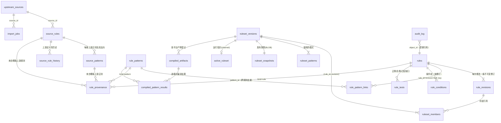

# SQLite 规则库：Schema、ER 图与示例 SQL

数据库文件：`data/ai_prompt_rules.db`（单文件，`journal_mode=delete`，约 13.9 MB）；Schema：`sql/001_init.sql`（migration 1，SHA-256 记录在 `schema_migrations`）。
可移植性：只使用 SQLite ≥ 3.24 的特性（无 STRICT / RETURNING / 约束内 JSON 函数），Ubuntu 20.04 / RHEL 8 自带的 SQLite 即可只读访问。**每个连接必须 `PRAGMA foreign_keys = ON`**（工具与 C++ CLI 都会设置）。时间一律是 UTC ISO-8601 文本。

> SQLite 是**唯一权威数据源**；快照 JSON、`.hsdb`、manifest、CSV 报告都是从它生成的，丢了可以重建，反过来不行。

## 1. ER 图



## 2. 表说明

| 表 | 作用 | 不可变性 / 约束 |
|---|---|---|
| `schema_migrations` | 已应用的 migration、文件 SHA-256 | 改动已应用的 migration 文件会被拒绝（`db check` 报告） |
| `id_counters` | 单调分配器：`pattern_id`（从 10001 起）、`ruleset_version_id`、每个类别的规则序号 | 数值**永不复用** |
| `upstream_sources` | 三个来源的仓库、commit、许可证、锁定树 hash、提取器版本 | — |
| `import_jobs` | 每次导入（含 dry-run）的计数与错误 | — |
| `source_rules` | **每一条上游规则**（867 条）及其决定：`included / partial / excluded_scope / excluded_language / unsupported / context_logic`，`decision_reason` 必填 | `(source_id, source_key)` 唯一 |
| `source_patterns` | **每一条上游正则**（3 614 条）及其去向 `fate` 和原因、转换备注 | 没有任何模式“消失”：被排除/不支持的也在这里 |
| `source_rule_history` | 上游定义变化前的旧版本 | — |
| `rules` | 统一规则的**当前头部**（稳定 `rule_id`、类别、语言、权重、置信度、状态、范围、上下文要求、评分组…） | `modified_locally` 标记被本地改过的上游规则；软删除 |
| `rule_revisions` | 规则每次变化的**完整冻结内容**（含条件树与叶子→模式映射）、作者、原因、前后 hash | **追加写**：触发器禁止 UPDATE/DELETE |
| `rule_patterns` | 规范化后的模式（`regex`、`flags`、`norm_profile`、`engine_class`、特征标签、最小/最大长度、`expr_hash`） | **不可变且按 `expr_hash` 去重**；禁止 DELETE |
| `rule_pattern_links` | 规则修订的叶子 → 模式（多对多） | 主键 `(rule_id, revision, leaf_key)` |
| `rule_conditions` | 条件树 JSON（`any/all/not/leaf`）按修订保存 | — |
| `rule_provenance` | 规则/模式 ↔ 上游规则/上游正则 ↔ commit | 回答“这条正则从哪来” |
| `rule_tests` | 测试样例：`positive / negative / mixed / known_gap`、字段、来源、`verification`（Python oracle 结果） | `(rule_id, kind, text_sha256)` 唯一 |
| `ruleset_versions` | 版本（语义化版本）、状态 `draft/published/retired`、`content_digest`、`snapshot_sha256` | 已发布版本被触发器**冻结**，不可删 |
| `ruleset_members` | 版本包含哪些 `(rule_id, revision)` | 非草稿版本不可增删改 |
| `ruleset_patterns` | 版本使用的 `pattern_id` | 同上 |
| `ruleset_snapshots` | **编译器和引擎消费的精确字节**（规范 JSON BLOB）+ sha256 | 同上 |
| `active_ruleset` | 运行指针（channel）；`activate`/`rollback` 只改这一行并写审计 | — |
| `compiled_artifacts` | 各平台产物登记（manifest hash、hsdb hash、后端、Hyperscan 版本、CPU 特性…） | 只能登记给已发布版本（触发器） |
| `compiled_pattern_results` | 逐模式最终编译结果与错误 | — |
| `audit_log` | **哈希链**审计日志（`prev_hash`/`entry_hash`），只含规则 ID 与计数，不含请求文本 | **追加写**；`db check` 重算整条链 |
| `rule_issues` | 待人工关注的问题（被排除的来源规则、部分转换…） | — |

视图：`v_rule_overview`（规则 + 模式数 + 正/负例数 + 来源）、`v_rule_patterns_current`、`v_source_rule_fates`、`v_version_summary`。

## 3. 数据库自身保证的不变量（触发器）

```text
trg_rule_patterns_immutable / _no_delete        模式不可改、不可删，pattern_id 永不复用
trg_rule_revisions_no_update / _no_delete       规则修订追加写
trg_audit_no_update / _no_delete                审计日志追加写
trg_ruleset_versions_frozen / _no_delete        已发布/已退役版本不可改、不可删
trg_ruleset_members_frozen_*  trg_ruleset_patterns_frozen_*  trg_ruleset_snapshots_frozen_*   非草稿版本的成员/模式/快照不可变
trg_artifacts_published_only                    只有已发布版本才能登记编译产物
```

这些在 `tests/python/test_database.py` 里逐条验证（直接对库发 UPDATE/DELETE，必须被拒绝）。**拥有文件写权限的人可以 `DROP TRIGGER`**——触发器防止的是误操作与工具缺陷，不是恶意者；哈希链审计 + 快照 SHA-256 让此类篡改在 `db check` 和加载阶段**可被发现**。

## 4. 示例 SQL（均已在交付的库上执行验证）

```sql
-- 4.1 规则总览：类别、语言、测试覆盖
SELECT rule_id, category, lang, severity, status, positive_tests, negative_tests
  FROM v_rule_overview ORDER BY rule_id LIMIT 10;

-- 4.2 启用规则按类别×语言统计
SELECT category, lang, COUNT(*) FROM rules WHERE status = 'enabled' GROUP BY 1, 2 ORDER BY 1, 2;

-- 4.3 这条规则从哪来（上游规则、文件、commit、转换决定）
SELECT s.source_id, s.source_key, s.source_path, p.source_commit, s.decision
  FROM rule_provenance p JOIN source_rules s USING (source_rule_id)
 WHERE p.rule_id = 'AIPS-PI-0001' AND p.kind = 'rule';

-- 4.4 哪些规则使用了某个模式（去重后一个模式可被多条规则引用）
SELECT DISTINCT l.rule_id
  FROM rule_pattern_links l JOIN rules r ON r.rule_id = l.rule_id AND r.revision = l.revision
 WHERE l.pattern_id = 10001;

-- 4.5 去重报告：被多个上游正则合并成同一个模式的 pattern_id
SELECT pattern_id, COUNT(*) AS source_patterns FROM rule_provenance
 WHERE kind = 'pattern' GROUP BY pattern_id HAVING COUNT(*) > 1 ORDER BY 2 DESC;

-- 4.6 每个来源的模式去向（原生 / 预过滤 / 语言排除 / 范围排除 / 不支持）
SELECT s.source_id, sp.fate, COUNT(*) FROM source_patterns sp JOIN source_rules s USING (source_rule_id) GROUP BY 1, 2;

-- 4.7 被排除 / 不支持的原因（上游规则级）
SELECT source_id, decision, substr(decision_reason, 1, 80) AS reason, COUNT(*) AS n
  FROM source_rules WHERE decision NOT IN ('included') GROUP BY 1, 2, 3 ORDER BY n DESC;

-- 4.8 缺少正例或负例的启用规则（交付库为 0 行）
SELECT rule_id FROM v_rule_overview WHERE status = 'enabled' AND (positive_tests = 0 OR negative_tests = 0);

-- 4.9 版本、产物数量与激活状态
SELECT version, status, rule_count, pattern_count, artifacts, is_active FROM v_version_summary;

-- 4.10 某个已发布版本包含的规则及其冻结修订
SELECT m.rule_id, m.revision FROM ruleset_members m JOIN ruleset_versions v USING (version_id) WHERE v.version = '1.0.0';

-- 4.11 一条规则的完整修订历史
SELECT revision, change_kind, actor, created_at, reason FROM rule_revisions WHERE rule_id = 'AIPS-IO-0032' ORDER BY revision;

-- 4.12 审计日志（最近 10 条）与被本地修改过的上游规则
SELECT audit_id, ts, actor, action, object_type, object_id FROM audit_log ORDER BY audit_id DESC LIMIT 10;
SELECT rule_id, name, revision FROM rules WHERE modified_locally = 1;

-- 4.13 本地“质量排除”与“引擎限制排除”的上游条件及原因（见 docs/rule-maintenance.md §6）
SELECT s.source_key, sp.locator, sp.fate_reason
  FROM source_patterns sp JOIN source_rules s USING (source_rule_id) WHERE sp.fate_reason LIKE 'local_quality%' OR sp.fate_reason LIKE 'engine_limit%';

-- 4.14 中文 / 中英混合规则
SELECT rule_id, name FROM rules WHERE status = 'enabled' AND lang IN ('zh', 'mixed') ORDER BY rule_id;

-- 4.15 需要 PCRE2 复核的（预过滤）模式及原因
SELECT pattern_id, class_reason FROM rule_patterns WHERE engine_class = 'hs_prefilter_pcre2';
```

## 5. 并发、备份与 WAL

- 规则管理（写）与扫描（读）是**解耦**的：运行时库不打开 SQLite；编译器只读打开。读者之间互不阻塞。
- 开发/管理副本可用 `rules.py db init --wal` 启用 WAL 以便读写并发；**交付/共享的单文件必须是 `journal_mode=delete`**，否则只拷贝 `.db` 会漏掉 `-wal` 里的事务。生成交付文件用 `rules.py db snapshot --out FILE`（在线备份 API → checkpoint → `journal_mode=DELETE` → `VACUUM` → `integrity_check` + `foreign_key_check` → 原子改名）。
- `rules.py db backup --out FILE`：SQLite 在线备份 API，写入时也能得到一致副本。`db restore --from FILE --force`：先校验来源，再保留 `*.before-restore` 安全副本，最后原子替换。
- `rules.py db check`：`integrity_check`、`foreign_key_check`、migration 校验和、审计哈希链。

## 6. 迁移策略

只前进：新增 `sql/00N_*.sql`；已应用的 migration 文件一旦被修改，工具拒绝继续（记录的 SHA-256 与文件不符）。每个 migration 在单个事务里执行并同时写入 `schema_migrations`。破坏性变更需要写数据迁移，并保持 `ruleset_snapshots` 的格式版本（`snapshot_format`）与 C++ 引擎的 `kSnapshotFormatVersion` 同步。
