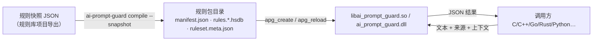
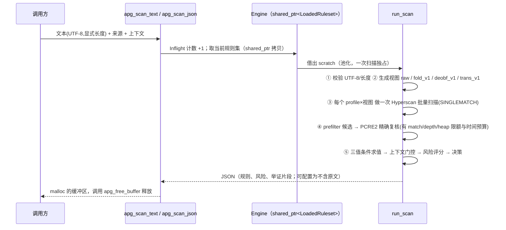

# 引擎架构 / Engine architecture

检测引擎是一个独立的 C++17 项目：进程内的检测库（稳定的 **C ABI**，同一份源码构建 Windows `DLL` 与 Linux `SO`）加一个命令行工具 `ai-prompt-guard`。它**只做三件事**：

1. **初始化**：`apg_create(配置)` 读取规则包（一个目录：`manifest.json` + `rules.*.hsdb` + `ruleset.meta.json`），把规则加载进内存。
2. **检测**：`apg_scan_text / apg_scan_json` 对文本做归一化、Hyperscan 批量匹配、PCRE2 复核、条件求值与评分，返回 JSON 结果。
3. **热更新**：`apg_reload` 换一个规则包，在途扫描不受影响。

引擎**不依赖规则库**：没有 SQLite，没有 Python，不知道规则从哪里来、怎么写。规则库是另一个独立项目（`../rules`），两者之间只有一份文件约定：规则快照 JSON（编译器的输入，`schemas/ruleset_snapshot.schema.json`）和规则包目录（编译器的输出、引擎的输入）。两边各自构建、测试、发布，互不要求对方的版本。

## 1. 目录与职责

| 目录 | 职责 |
|---|---|
| `include/ai_prompt_guard.h` | 唯一的公共 C ABI |
| `src/core/` | UTF-8 / JSON / SHA-256 / 归一化、Hyperscan 与 PCRE2 后端、场景评估（`scanner.cpp`） |
| `src/ruleset/` | 快照解析、规则包加载（`manifest.cpp`）、**规则编译器**（`compiler.cpp`） |
| `src/api/` | `Engine` 对象（热更新/销毁协议）与 C ABI 外壳 |
| `cli/` | `ai-prompt-guard`：compile · verify · info · scan · scan-batch · bench |
| `schemas/` | 配置、请求、响应、info、manifest、编译报告、活动指针、快照的 JSON Schema |
| `examples/` | C · C++ · dlopen · LoadLibrary · Python ctypes · Go cgo · Rust FFI · 交互式 `scan_loop` · 实时基准 `bench_live` |
| `tests/` | C++ 单元测试、Schema 与静态检查（Python，仅标准库）、基准用语料 |
| `scripts/{linux,windows}/` | 依赖检查、构建、静态 Hyperscan、测试、基准（显式）、打包 |

## 2. 规则编译器

规则包由 `ai-prompt-guard compile --snapshot FILE` 生成。它读取规则快照，按归一化 profile 分组，用 Hyperscan 编译：每条模式先单独尝试原生编译；被 Hyperscan 拒绝或超时的降级为 prefilter（PCRE2 能复核才接受），仍不行的放宽大范围重复，最后才**隔离**并在 `build_report.json` 里给出确切错误。通过的模式按并行线程数分片，每片一次 `hs_compile_multi`。写入 `.building` 临时目录，加载自检通过后原子改名。

编译出的 `.hsdb` 由编译它的那一版 Hyperscan 加载；Hyperscan 自己会拒绝版本或 CPU 特性不兼容的数据库，引擎默认不再做 manifest 上的哈希、版本、平台校验（配置 `verify_ruleset=true` 或 `ai-prompt-guard verify` 才做）。

## 5. 运行期数据流

要点：

- **每个 profile 每个视图只扫描一次**（不是逐条规则扫描）；相同的视图（归一化后与原文一致）只扫一遍。
- **只有 PCRE2 复核成功的命中才进入风险判定**；复核超限/超时记为 warning，并按 `policy.on_verify_error` 决定是否升到 `review`。
- 输入问题（非法 UTF-8、过长、候选过多）不会让 C 函数失败，而是返回 `status:"error"` 的结构化结果，决策取自 `policy.on_error`（默认 `review`，不会悄悄放行）。
- 结果里的 `evidence` 带命中的原文片段和所在句子（`output.include_evidence_text`，默认开）；需要“结果不含任何请求文本”的场景把它设为 `false`，只留偏移量。

## 6. 规则模型与评分语义

**统一规则** `AIPS-<类别码>-NNNN`（稳定 ID，`id_counters` 单调分配，删除只做软删除）：

| 字段 | 含义 |
|---|---|
| `category` | prompt_injection / jailbreak / role_spoofing / instruction_override / instruction_hijacking / system_prompt_extraction / safety_bypass / obfuscated_injection / data_exfiltration_instruction |
| `severity` | info…critical：**影响有多大**，不是置信度 |
| `weight`、`confidence` | 风险 = `weight × confidence × 来源系数`；`confidence` 表示“命中后真是攻击的概率” |
| `condition` | `any / all / not` 条件树，叶子 = (pattern_id, field)。ATR 的多条件、`NOT`、字段约束完整保留 |
| `scope` / `context_requires` | 如 `translation_only` → 需要请求上下文 `{"task":"translation"}` |
| `score_group` | 同组规则只计最大值，不叠加（上游 trans 检测器的各组；以及“证据完全相同”的规则自动同组） |

**三值逻辑**：叶子所需字段**没有提供**时取值 *unknown*（不是 false）。`any`：有真即真，全假才假，否则 unknown；`all`：有假即假，全真才真，否则 unknown；`not` 保持 unknown。unknown 且已有部分证据 → 记入 `needs_context`（`reason: field_missing`），**不计入分数**。上下文缺失同理（`context_missing`）；上下文不匹配则规则“不适用”，什么也不报。

**评分**：每条命中规则的风险 = `weight × confidence × 来源系数`（user_input 1.00，tool_output/rag_document 1.15，agent_message 1.10），截断到 [0,1]；同 `score_group` 取最大；各组按 noisy-OR 合成：`score = 1 − Π(1 − risk_g)`。

**决策**（默认阈值，可由配置覆盖）：`score ≥ 0.50 → alert`；`≥ 0.30 → review`；否则 `allow`。`score ≥ 0.85` 且 `policy.allow_block=true` 才是 `block`。`needs_context` 里的规则**永远不计入分数**，但如果其风险 ≥ `needs_context_review_at`（默认 0.50，即“补上上下文就会 `alert`”），`allow` 会被抬到 `review`（“降一档”，绝不会抬到 `alert`——条件并未成立）。没有翻译类场景的部署可以用 `policy.needs_context_review_at`（1.0 ≈ 关闭）降低噪声；发现仍然会出现在 `needs_context[]` 里。

风险等级：`≥0.80 critical`、`≥0.60 high`、`≥0.40 medium`、`≥0.15 low`，其余 `info`；无命中 `none`。

> 这些数值是**默认值与设计选择**，不是经过大规模真实流量校准的结论；见 `reports/false_positive.md` 的限制说明。

## 7. 归一化（版本化，`tables_version = 1`）

| profile / view | 作用 |
|---|---|
| `raw` | 原文 |
| `fold_v1` | 删除不可见/格式/双向控制字符（零宽、BOM、RLO…）→ 单字符 NFKC（全角→半角、花体、连字…）→ ATR 的西里尔/希腊形近字映射到拉丁。**中文不变。** 每个字节带原文偏移 |
| `deobf_v1` | 在 `fold_v1` 之上的反混淆视图（无新增表）：① CJK 字符之间的分隔符（空格、`.` `-` `_` `*` `|` `/` 等，**不含**逗号、分号、换行等句读）删除，`忽 略 之 前` → `忽略之前`；② 3 个以上单个 ASCII 字母被**同一种**分隔符连接（`i.g.n.o.r.e`）时连成词；③ 词内 leetspeak 还原（至少 3 个字符、含字母和 leet 字符的 token：`0→o 3→e 4→a 5→s 7→t @→a $→s`，`1→i`，连续两个以上的 `1`→`l`），纯数字 / 价格不动。偏移照常映射回原文 |
| `trans_v1` | 翻译检测器 `preprocess_text` 的精确复刻（去首尾空白、零宽、同形字、控制符、CJK 标点→ASCII…），**不做小写**（该来源的模式编译为不区分大小写） |

规则 profile `fold_v1` 同时扫 `fold_v1` 与 `raw` 两个视图（ATR 语义：归一化视图优先，原文兜底）；profile `deobf_v1` 依次扫 `deobf_v1`、`fold_v1`、`raw`（1.1.0 起除翻译来源外的全部规则使用它，所以 1.0.0 的命中是 1.1.0 的子集）。`deobf_v1` 只在文本确实被改动时才多扫一遍。C++ 表由 `tools/gen_unicode_tables.py` 从 Python `unicodedata` 生成并随源码提交（Unicode 16.0.0），`tests/fixtures/normalize_golden.jsonl` 是 Python 规范与 C++ 实现的共同黄金向量（C++ 侧待 Linux 验证）。

## 9. 并发与热更新（设计）

- `apg_context_t` 可被任意多线程共享；每次扫描独占一个 scratch（池化，数量上限可配置，不会跨线程共享）。
- `apg_reload`：新规则集的**全部**加载与校验（含创建首个 scratch）完成后才原子替换 `shared_ptr`；在途扫描继续使用旧规则集；失败时旧规则集原样保留。
- `apg_destroy` 等待“在它之前已经开始”的扫描/重载结束；销毁之后（或与之并发地）再使用句柄是调用方的错误（任何 C API 都无法防御）。

## 3. 设计决策

| 决策 | 理由 | 代价 / 风险 |
|---|---|---|
| 引擎与规则库分成两个项目 | 引擎改动只重新编译引擎，规则改动只升级规则，互不影响 | 编译器在引擎项目里（用同一份 Hyperscan 编译），规则库项目把它当黑盒工具调用 |
| 运行期不访问 SQLite、不编译正则 | 低延迟、无外部依赖、行为可预期 | 规则需要预先编译成规则包 |
| 显式 `pcre2_fallback` 后端 | Windows 上 Hyperscan 风险高；也作为差分测试的对照 | 更慢；结果里始终标注 `backend`，绝不冒充 hyperscan |
| 默认 alert-only | 正则规则不适合直接拦截；避免误伤正常文档/合法角色扮演 | 需要调用方根据业务自己处理 `alert/review` |
