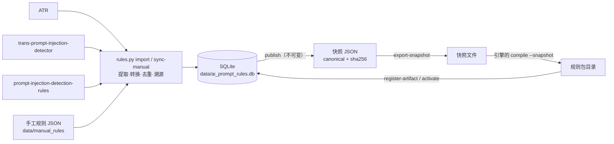

# 规则库架构 / Rules architecture

规则库是一个独立的项目：**SQLite 是规则的唯一权威来源**，加一套 Python 工具链（仅标准库）。它负责导入三个开源规则源、维护手工规则、校验、发布不可变的版本，并导出**规则快照 JSON**；把快照编译成规则包的是引擎项目的编译器（`ai-prompt-guard compile`），本项目把它当黑盒工具调用。规则库不依赖引擎的源码，只通过两个文件与引擎相连：快照 JSON（给编译器）和规则包目录（编译器的输出，随后给引擎加载）。



## 1. 目录

| 目录 | 职责 |
|---|---|
| `tools/apg_rules/`、`tools/rules.py` | 来源同步与锁定、YAML/AST 提取、正则转换与分类、导入、维护、校验、发布、参考引擎、报告 |
| `tools/sources/` | 三个上游的 importer 插件 |
| `tools/update_rules.py`、`tools/build_rules_db.py` | 日常增量更新；从零重建规则库 |
| `tools/diff_hyperscan.py` | 用编译好的引擎（共享库）与参考引擎做差分，对引擎是黑盒 |
| `sql/001_init.sql` | SQLite schema（含不可变性触发器、视图） |
| `data/` | 权威规则库 `ai_prompt_rules.db`（及 `.sha256`）、`manual_rules/*.json` |
| `third_party/` | 三个上游仓库的干净快照与 commit 锁 |
| `schemas/` | 规则规格、快照、活动指针的 JSON Schema |
| `tests/` | Python 单元测试、`corpus/`（语料与预期结果）、`e2e/`（用真实引擎做端到端与差分）、`fixtures/` |
| `scripts/linux/` | `init_rules.sh`（导出快照→编译→登记→激活）、`package_rules.sh`（打包规则包） |
| `reports/`、`LICENSES/` | 统计与评估报告 · 上游许可证与署名 |

## 2. 数据流

1. `sources sync --locked`：把三个仓库物化为**无 .git 的干净快照**（`third_party/sources/`），每个文件的 SHA-256 与整棵树的 hash 写进 `third_party/sources.lock.json`。ATR 含 Windows 非法文件名，所以不用 `git checkout`，而是 `git cat-file --batch` 读取对象并自行校验路径。
2. `import`：每个 importer 把上游规则变成统一的 `SrcRule`/`SrcPattern`（**不执行上游代码**：ATR 用自带的 `miniyaml`，两个 Python 来源用 `ast`）。`pipeline.prepare_rule` 对每个模式做 `convert_pattern`：
   - 方言（ES / Python `re` / PCRE）→ 统一的“PCRE 兼容 + Hyperscan 可编译”规范形式，flags 取 `imsu` 子集；
   - ES 语义还原（`.`、`\s`、`$`、代理对写法）、Python 语义（`\Z`→`\z`）、lookbehind 展开；
   - 语言作用域：对外语（日/德/韩/西…）的分支做**精确子集裁剪**，整条都是外语则 `excluded_language`，并保留证据；
   - 分类：`hs_native`（真正正则语言）/ `hs_prefilter_pcre2`（含 lookahead、反向引用、原子组…，Hyperscan 只做预过滤，必须经 PCRE2 复核）/ `unsupported`（可空匹配、孤立代理、变长 lookbehind、语义类方法）。
3. 去重：同一 `(regex, flags, profile)` 只有一个 `pattern_id`（从 10001 起，永不复用）；规则通过 `rule_pattern_links` 引用。同一证据的两条规则在发布时被分到同一 `score_group`（见 §6）。
4. `verify-tests`：用 **Python 参考引擎** 复算上游所有测试样例（含 ATR 的多输入字段语义）；不一致或不可编译的会被标记，不会静默通过。
5. `publish`：只从不可变的 `rule_revisions` / `rule_patterns` 生成**规范 JSON 快照**（键排序、无空白、UTF-8），其 SHA-256 写入 `ruleset_versions.snapshot_sha256`；发布后的版本被触发器冻结。两次全新构建得到逐字节相同的快照（已验证）。
6. 导出快照并编译：`rules.py export-snapshot` 写出已发布快照，引擎的 `compile --snapshot` 读取它 → 按归一化 profile 分组 → `hs_compile_multi`（`HS_FLAG_UTF8|SINGLEMATCH`，需要时 `PREFILTER`）→ 出错的单个表达式先降级为 prefilter（PCRE2 能复核才接受），再不行就**隔离**并在 `build_report.json` 里给出确切错误、使用它的规则和上游溯源；写 `.building` 临时目录、**加载自检**通过后原子改名。


## 3. 规则模型

一条规则的内容分散在四张表：`rules`（描述信息，无正则）、`rule_conditions`（条件树）、`rule_pattern_links`（叶子名到 `pattern_id`）、`rule_patterns`（正则本体）。

```
rules ──(rule_id + revision)──► rule_conditions       “怎么组合”：all(p1, p2)
  │
  └──(rule_id + revision)──► rule_pattern_links        “p1→11568，p2→11569”
                                  │
                                  └──(pattern_id)──► rule_patterns    “正则本体”
```

- 一条规则可由多条正则组成并带逻辑关系（`all` / `any` / `not`）；`rule_patterns` 按（正则、标志、归一化方式）去重，可被多条规则共用。
- `rule_patterns` 不可改、不可删（触发器保证）；条件与 link 带 `revision`；发布的版本通过 `ruleset_members` 固定到具体的 `(rule_id, revision)`，所以旧版本始终可重编译、可回滚。
- 三张表要用 `rule_id` 加 `revision` 连接，不能只用 `rule_id`。

评分、条件三值逻辑和归一化是**引擎**的语义（见引擎项目的 `docs/architecture.md`）；本项目的参考引擎（`tools/apg_rules/refengine.py`、`normalize_ref.py`）独立实现同一规格，用于校验规则自带样例和生成差分测试的预期结果。`tools/gen_unicode_tables.py` 生成引擎使用的 Unicode 表和黄金向量，写入引擎项目里的提交副本。

## 4. 版本与产物

- 发布版本（`ruleset_versions`）与其成员/模式/快照由触发器冻结；`rollback` 只移动 `active_ruleset` 指针并写审计，**从不改历史**。
- 规则包目录里的 `manifest.json` 记录快照的 SHA-256、各 `.hsdb` 的 SHA-256 和编译环境；`active.json` 是指向当前版本清单的指针。`register-artifact` 把编译产物登记进 SQLite，`activate` 写 `active.json`。
- `.hsdb` 由编译它的那一版 Hyperscan 加载：要用与你部署的引擎同一份 Hyperscan 的 `ai-prompt-guard` 来编译。

## 5. 关键设计决策

| 决策 | 理由 | 代价 / 风险 |
|---|---|---|
| Python 规则工具链 | 规则管理需要灵活的文本处理；运行期不依赖解释器 | 规则管理需要 Python 3 |
| 自带 `miniyaml` | 构建机无 PyYAML 且不得安装；`yaml.load` 对不可信输入不安全 | 只支持上游用到的子集，遇到不认识的语法**报错而非跳过** |
| 不执行上游代码，用 AST/安全 YAML 解析 | 供应链安全 | 上游改写法时 importer 需更新（有断言保护） |
| 快照 canonical JSON + SHA-256 | 可复现、可比对、可审计 | 快照约 2 MB |
| 参考引擎（Python `re`）独立存在 | 无编译器时也能验证转换与规则语义，并生成差分测试的预期结果 | Python `re` ≠ Hyperscan/PCRE2：边角语义可能不同，需用真实引擎做差分 |
